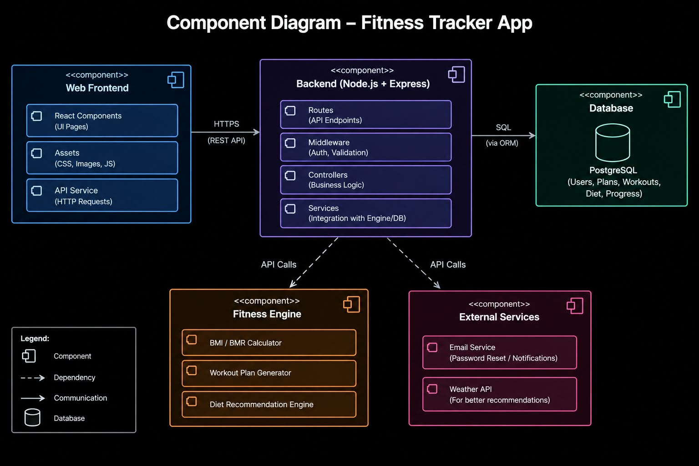

# STHIRA | AI-Powered Fitness & Wellness Platform

**Track your progress. Understand your nutrition. Train smarter.**

STHIRA is a full-stack fitness and wellness platform designed to bring workout tracking, nutrition management, health monitoring, and AI-assisted coaching into a unified application.

Built using React, Node.js, Express.js, and PostgreSQL, STHIRA enables users to manage their fitness activities, monitor nutritional intake, record daily wellness metrics, and receive personalized recommendations through AI integration.

The platform combines conventional fitness tracking with intelligent features such as AI-powered food image analysis, nutrition lookup, and context-aware fitness and dietary recommendations.

---

## ✨ Features

### 🤖 AI Fitness Coach
- AI-assisted fitness and nutrition recommendations using locally hosted Ollama models.
- Uses logged meals, workout activities, and daily wellness information to provide contextual recommendations.
- Considers steps, water intake, sleep duration, and recovery ratings.
- Supports alternative rule-based recommendations when generative AI is unavailable.
- Provides personalized dietary guidance and meal planning.

### 📸 AI Food Snap
- Analyze food images using Google's Gemini AI.
- Identify food items and estimate their nutritional information.
- Extract potential food items and portion estimates from uploaded images.
- Match recognized foods with nutritional information from USDA FoodData Central.
- Review estimated nutritional values before adding meals to the diet log.

*Food recognition and portion estimates are approximate and should be reviewed before logging.*

### 🥗 Nutrition Management
- Search food items using the USDA FoodData Central API.
- Retrieve nutritional information, including calories, protein, carbohydrates, fats, fiber, sugar, and sodium where available.
- Save food information for subsequent use.
- Record meals and monitor daily nutritional intake.
- Track consumed meals and their nutritional contributions.
- Connect dietary records with dashboard progress and AI recommendations.

### 🏋️ Workout & Activity Tracking
- Record different workout activities and exercise durations.
- Track completed and pending workouts.
- Estimate calories burned during physical activities.
- Maintain workout history.
- Monitor exercise consistency and activity progress.

### 💧 Daily Wellness Tracking
- Record daily step counts.
- Monitor water consumption.
- Track sleep duration.
- Record self-reported recovery ratings.
- Maintain daily wellness records.
- Use wellness information to support personalized AI recommendations.

### 📊 Progress Analytics
- Monitor fitness progress through a centralized dashboard.
- Visualize workout and activity history.
- Track changes in body weight.
- Monitor nutrition and wellness records.
- Review historical fitness information through graphical representations.
- Evaluate consistency across daily fitness activities.

### 🔐 Authentication & Data Protection
- User registration and login.
- Password hashing using bcrypt.
- JWT-based authentication.
- Protected backend API endpoints.
- Session-based authentication using secure cookie configuration.
- User-specific data access and authorization.

---

## 🛠️ Technology Stack

| Category | Technologies |
|---|---|
| Frontend | React, JavaScript |
| Styling | Tailwind CSS |
| Build Tool | Vite |
| Backend | Node.js, Express.js |
| Database | PostgreSQL |
| Database Driver | node-postgres (pg) |
| Authentication | JWT, bcrypt |
| AI Integration | Ollama, Google Gemini API |
| AI Model | Qwen 2.5 (3B) |
| Nutrition Database | USDA FoodData Central API |
| Data Visualization | Recharts |
| API Architecture | REST APIs |
| Development Tools | Git, GitHub, npm |

---

## 🏗️ System Architecture

STHIRA follows a client-server architecture in which the React frontend communicates with the Express backend through REST APIs.

The backend manages authentication, application logic, database operations, and integrations with external services.

```text
                    STHIRA
                       |
             React Frontend (Vite)
                       |
                  REST APIs
                       |
              Node.js + Express
                       |
        +--------------+--------------+
        |              |              |
   Authentication   AI Services   Nutrition API
        |              |              |
      JWT          Ollama          USDA FoodData
     bcrypt        Gemini          Central API
        |              |              |
        +--------------+--------------+
                       |
                  PostgreSQL
                       |
        +--------------+--------------+
        |              |              |
    User Data      Food Logs      Wellness Logs
        |              |              |
        +--------------+--------------+
                       |
               Progress Analytics
```

### Component Diagram



---

## 📂 Project Structure

```text
Fitness-Tracker/
│
├── client/
│   ├── src/
│   │   ├── components/
│   │   │   ├── food/
│   │   │   ├── AICoachCard.jsx
│   │   │   ├── ActivityChart.jsx
│   │   │   ├── NavBar.jsx
│   │   │   ├── Sidebar.jsx
│   │   │   ├── StatCard.jsx
│   │   │   └── WellnessTrendChart.jsx
│   │   │
│   │   ├── pages/
│   │   │   ├── Activity.jsx
│   │   │   ├── Dashboard.jsx
│   │   │   ├── Diet.jsx
│   │   │   ├── Login.jsx
│   │   │   ├── Progress.jsx
│   │   │   ├── Register.jsx
│   │   │   └── Workout.jsx
│   │   │
│   │   └── services/
│   │       ├── api.js
│   │       └── foodApi.js
│   │
│   ├── index.html
│   ├── package.json
│   └── vite.config.js
│
├── server/
│   ├── controllers/
│   ├── db/
│   ├── middleware/
│   ├── migrations/
│   ├── routes/
│   │   ├── authRoutes.js
│   │   ├── coachRoutes.js
│   │   ├── dietRoutes.js
│   │   ├── foodRoutes.js
│   │   ├── progressRoutes.js
│   │   ├── wellnessRoutes.js
│   │   └── workoutRoutes.js
│   │
│   ├── services/
│   ├── package.json
│   ├── database.js
│   └── server.js
│
├── .env.example
├── package.json
├── Component_diagram.png
└── README.md
```

---

## 🚀 Getting Started

### Prerequisites

Make sure you have the following installed:

- Node.js (LTS recommended)
- npm
- PostgreSQL
- Git
- Ollama (for local AI coaching)

Optional services:

- Google Gemini API key (for AI Food Snap).
- USDA FoodData Central API key (for food and nutrition searches).

### 1. Clone the Repository

```bash
git clone https://github.com/oliraman9031/Fitness-Tracker.git

cd Fitness-Tracker
```

### 2. Install Backend Dependencies

```bash
cd server

npm install
```

### 3. Configure Environment Variables

Create a `.env` file inside the `server` directory.

Use the provided `.env.example` as a reference.

```env
PORT=5000

DB_USER=your_postgres_username
DB_HOST=localhost
DB_NAME=sthira
DB_PASSWORD=your_postgres_password
DB_PORT=5432

CLIENT_ORIGIN=http://localhost:5173
SESSION_COOKIE_SECURE=false

USDA_API_URL=https://api.nal.usda.gov/fdc/v1
USDA_API_KEY=your_usda_api_key

GEMINI_API_KEY=your_gemini_api_key
GEMINI_MODEL=gemini-flash-lite-latest

AI_PROVIDER=ollama
AI_MODEL=qwen2.5:3b
OLLAMA_BASE_URL=http://127.0.0.1:11434
```

For AI Food Snap, configure your Gemini API key.

The Gemini integration is optional. Similarly, USDA integration requires a valid API key for food search functionality.

**Important:** Never upload your actual `.env` file, database password, or API credentials to GitHub.

### 4. Configure PostgreSQL

Create a PostgreSQL database named:

```sql
CREATE DATABASE sthira;
```

Make sure the database credentials match your `.env` configuration.

The backend initializes the required database tables and applies the project's registered migrations during startup.

### 5. Configure Ollama

Install Ollama and download the configured model:

```bash
ollama pull qwen2.5:3b
```

Start the Ollama service:

```bash
ollama serve
```

Keep Ollama running while using AI-powered coaching.

The AI provider can also be changed through the backend environment configuration.

### 6. Start the Backend

Open a terminal inside the `server` directory:

```bash
npm run dev
```

The backend runs on:

```text
http://localhost:5000
```

### 7. Start the Frontend

Open another terminal:

```bash
cd client

npm install

npm run dev
```

Vite will provide a local development URL, typically:

```text
http://localhost:5173
```

Open the URL in your browser to access STHIRA.

---

## 🔌 API Overview

The backend exposes REST API endpoints for authentication, fitness activities, nutrition, wellness tracking, and AI services.

| Endpoint | Functionality |
|---|---|
| `/api/auth` | User registration and authentication |
| `/api/progress` | Fitness progress records |
| `/api/diet` | Diet and meal management |
| `/api/workouts` | Workout and exercise tracking |
| `/api/wellness` | Daily wellness records |
| `/api/coach` | AI fitness and nutrition recommendations |
| `/api/food/search` | Search USDA food database |
| `/api/food/:fdcId` | Retrieve food nutritional details |
| `/api/food/ai-snap` | Analyze uploaded food images |
| `/api/food/ai-snap/usda-match` | Match recognized food with USDA nutrition data |
| `/api/health` | Backend and database health check |

*Protected endpoints require authentication. Exact HTTP methods and request parameters are defined in the respective route files.*

---

## 🔒 Security & Reliability

- Password hashing using bcrypt.
- JWT-based authentication.
- Protected API routes using authentication middleware.
- User-specific database queries.
- Server-side API key management.
- Input validation for incoming requests.
- Image upload restrictions and file validation for AI Food Snap.
- Database initialization and migration management.
- Error handling for external API failures.
- Configurable CORS and session cookie settings.

---

## 🗺️ Future Improvements

Potential areas for further development include:

- Integration with wearable fitness devices.
- Advanced machine-learning-based fitness predictions.
- More detailed nutrition and health analytics.
- Expanded workout recommendations based on individual performance.
- Automated testing and continuous integration.
- Cloud deployment and production monitoring.
- Improved long-term fitness trend analysis.

---

## 🎯 Engineering Concepts

STHIRA demonstrates practical implementation of:

- Full-stack web application development.
- RESTful API development and integration.
- Relational database design and management.
- Authentication and authorization.
- Third-party API integration.
- Generative AI and local LLM integration.
- AI-powered image analysis.
- Nutrition data processing.
- Data visualization and progress analytics.
- Backend validation and error handling.

---

## 👨‍💻 Author

**Raman Oli**

GitHub: [@oliraman9031](https://github.com/oliraman9031)

Project: [STHIRA – Fitness Tracker](https://github.com/oliraman9031/Fitness-Tracker)

---

*STHIRA — Building consistency through intelligent fitness and wellness tracking.*
